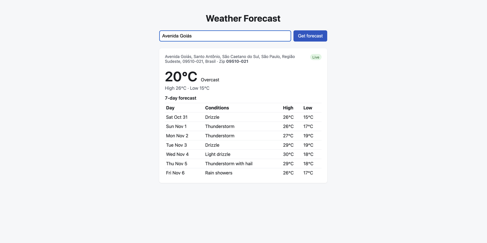

# Weather Forecast

Rails app that takes an address and shows the current temperature, today's high/low and a 7-day forecast. Results are cached by zip code for 30 minutes, and the page tells you when a result came from the cache.

Uses Nominatim (OpenStreetMap) to get the zip and coordinates for an address, and Open-Meteo for the weather. Neither needs an API key.



## Running

With Docker (app + Redis):

```sh
docker compose up --build
```

Then open http://localhost:3000. Use `PORT=3456 docker compose up --build` if 3000 is taken.

Without Docker:

```sh
bundle install
bin/rails server
```

## Tests

```sh
bin/rails test
bin/ci   # rubocop, brakeman, bundler-audit and tests
```

HTTP calls are stubbed with WebMock, so tests never hit the real APIs.

## Code

- `app/services/forecast_service.rb`: geocoding, weather call, caching and error handling
- `app/controllers/forecasts_controller.rb`: handles the form and shows errors
- `app/views/forecasts/index.html.erb`: the page

## Notes

Caching: the forecast is stored in `Rails.cache` under `forecast/v1/<country>/<zip>` for 30 minutes. Geocoding results are cached for a day so repeat addresses don't hit Nominatim again. In Docker the cache is Redis with a 64MB limit and `allkeys-lru`, so old entries get evicted when memory fills up. If Redis goes down the app just treats it as a cache miss and keeps working.

Errors: both API calls have connect/read timeouts. Timeouts, network errors, rate limits, 5xx and bad JSON show a friendly message (503) instead of crashing. Unknown addresses or ones without a zip return 422.

Scaling: the app doesn't keep any state of its own, so you can run more instances behind a load balancer and they all share the same Redis cache. `race_condition_ttl` keeps a popular zip from being refetched by many requests at once when it expires.

Trade-offs:
- I picked free, keyless APIs so it runs without setup. Nominatim is rate limited (about 1 req/s) and sometimes matches the wrong street, so for real traffic I'd use a paid geocoder.
- Caching by zip means everyone in the same zip sees the same forecast, which is what the requirement asks for but is less precise for big zip codes.
- There's no database since nothing needs to be saved.

If I had more time I'd add retries, a circuit breaker for the APIs, and some metrics on cache hit rate.
